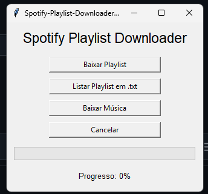
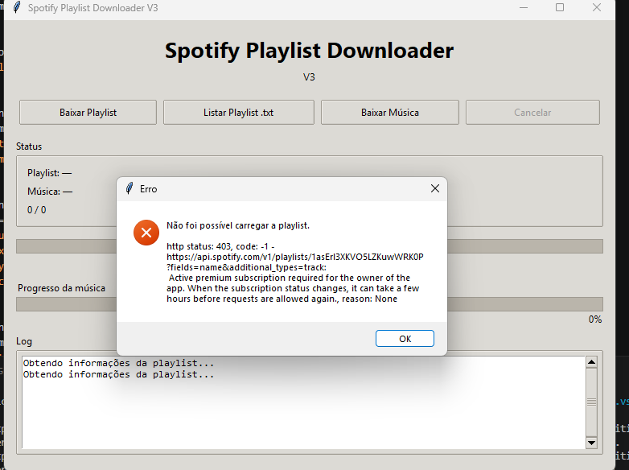
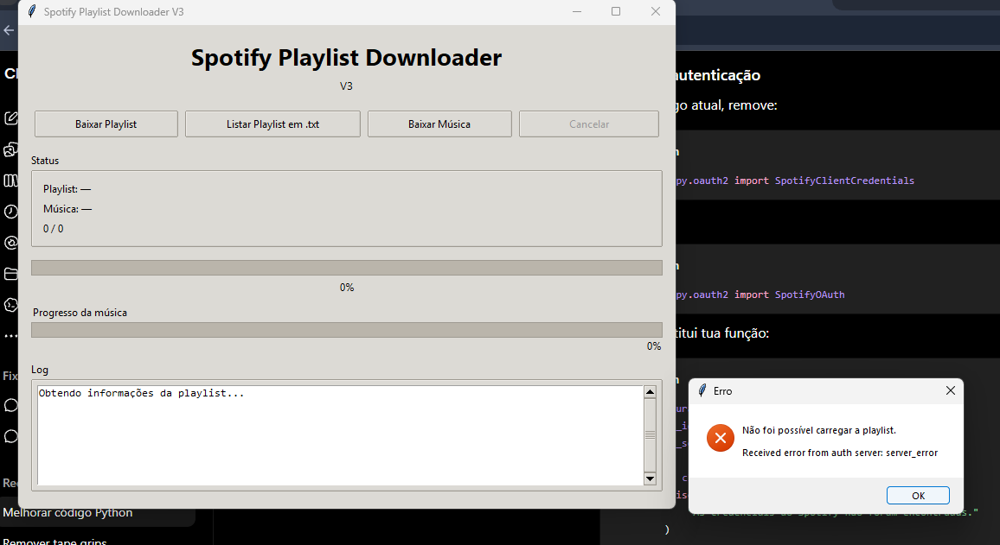
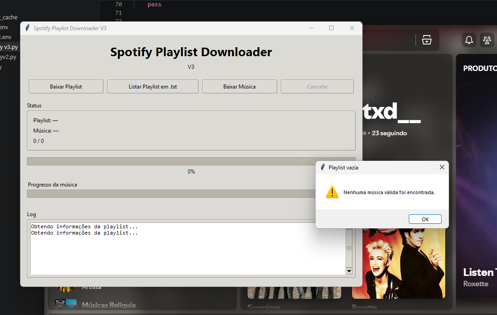
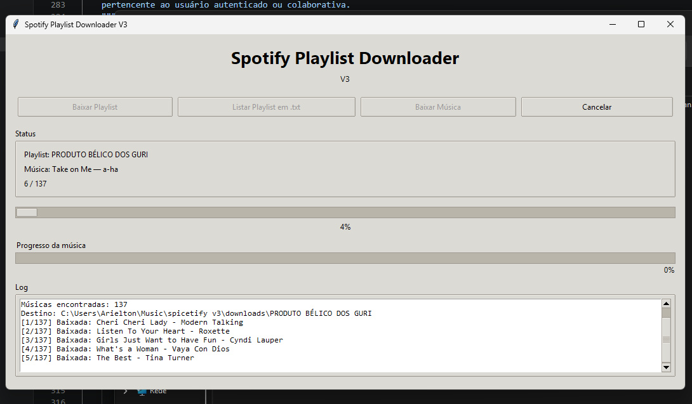
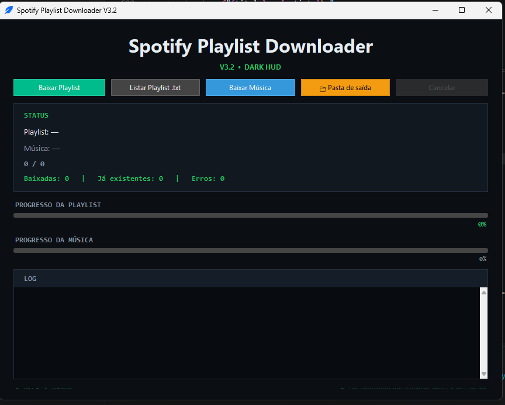
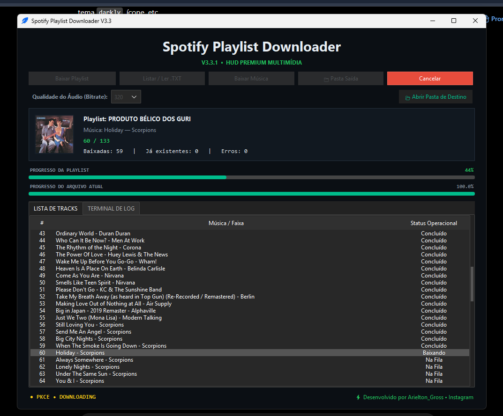
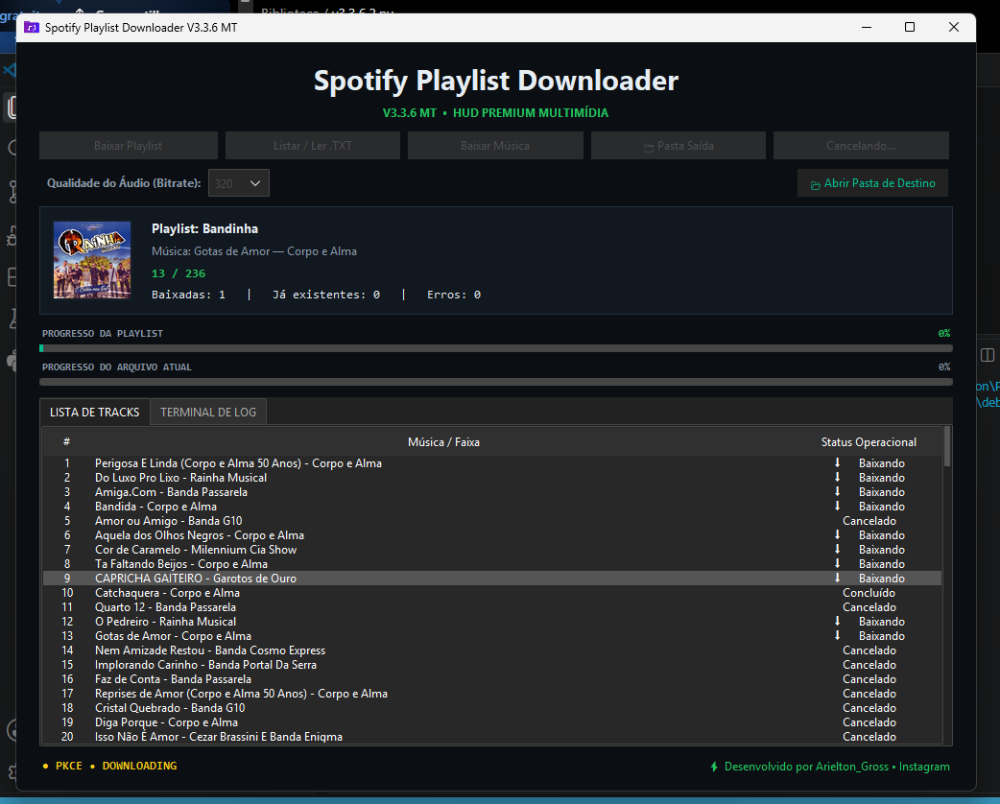
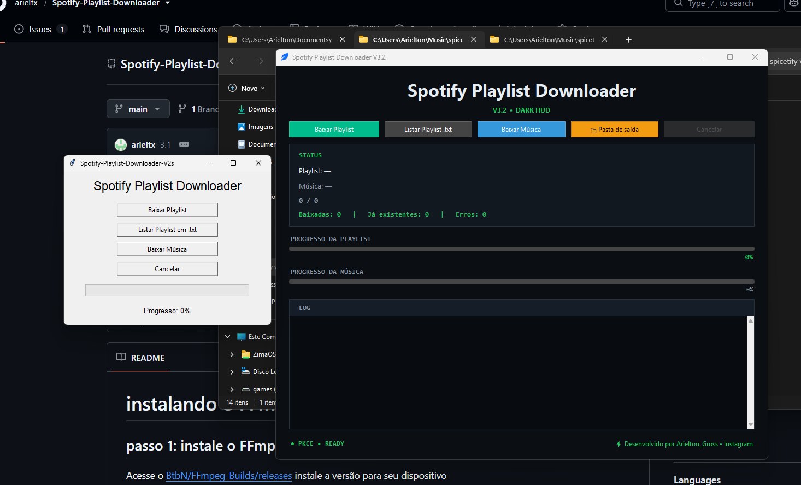

# Spotify Playlist Downloader (SPD) 🎧⚡

O **Spotify Playlist Downloader** é uma aplicação desktop de alta performance desenvolvida em Python. Ele permite converter e baixar músicas ou playlists completas do Spotify para o formato MP3 com taxa de bits (bitrate) selecionável de até 320kbps. 

A partir da versão 3.3+, o projeto foi totalmente reestruturado para utilizar **concorrência Multi-threading**, trazendo uma interface gráfica HUD escura moderna, barra de logs em tempo real e embutimento automático de metadados e capas.

---

## 🖼️ Linha do Tempo e Evolução Visual

O projeto passou por um criterioso processo de amadurecimento lógico, correções de escopo de API e total reformulação de design:

### 📦 O Começo (Versão V2s)
A primeira geração contava com uma interface minimalista em coluna única, baseada nos componentes padrão do Tkinter nativo, sem suporte a logs detalhados ou barras de progresso avançadas:

<p align="center">
  
</p>

### ❌ Desafios Críticos de API (Versões V3 Cruas)
Durante a transição para a arquitetura V3, o motor de requisições enfrentou instabilidades severas de autenticação, loops de paginação inválida e restrições de escopo de usuários (HTTP 403 / Server Error):

<p align="center">
  
  
  
</p>

### 🟢 Estabilização da Lógica e Modo Escuro (Versões V3.1 & V3.2)
Implementação do fluxo estável de paginação de faixas e introdução das primeiras variantes de telas escuras (`DARK HUD`) focadas em monitoramento via caixas de texto puro:

<p align="center">
  
  
</p>

### 🔵 Transição Multimídia Avançada (Versões V3.3 & V3.3.6 MT)
Evolução direta dos seletores visuais em blocos coloridos e a subsequente construção do painel multimídia com suporte a tabelas assíncronas e renderização de capas:

<p align="center">
  
  
</p>

### ⚡ Comparativo Geral de Gerações
Abaixo, a evolução clara comparando o antes e o depois das principais mudanças de layout do software:

<p align="center">
  
</p>

---

## ✨ Principais Recursos da Versão Atual (V3.3.7)

- **Arquitetura Multi-threaded:** Baixa até 12 músicas simultaneamente de forma assíncrona.
- **Segurança Anti-Flag:** Chaves de API e Client IDs protegidos por camada de ofuscação em tempo de execução, garantindo conformidade com o GitHub Secret Scanning.
- **Cancelamento Cooperativo Seguro:** O botão "Cancelar" interrompe o `yt-dlp` e os workers ativos imediatamente através de ganchos de progresso (`progress_hook`), limpando arquivos temporários (`.part`/`.ytdl`) de forma limpa.
- **Injeção de Metadados via Mutagen:** Tags ID3 completas inseridas de forma nativa nos arquivos MP3 (Título, Artista, Álbum e Arte do Álbum).
- **Deduplicação Avançada:** Verificação automática que ignora faixas repetidas em listas e arquivos locais, normalizando nomes e removendo sufixos redundantes do Windows (como `(1)`, `(2)`).
- **Importação/Exportação via Lote:** Leia arquivos `.txt` contendo links ou nomes de músicas para baixar em massa, ou exporte uma playlist do Spotify direto para texto.

---

## 🚀 Como Configurar e Executar

### Pré-requisitos
- **Python 3.10 ou superior**
- **FFmpeg:** Essencial para a conversão realizada pelo `yt-dlp`. Certifique-se de que o executável está no PATH do sistema ou em uma pasta chamada `ffmpeg/` na raiz do projeto.

### 1. Clonar o Repositório e Instalar Dependências
```bash
git clone https://github.com
cd spotify-playlist-downloader
pip install -r requirements.txt
```

### 2. Rodar o Aplicativo
```bash
python V3.3.7.py
```

---

## 🛠️ Como Gerar o Executável (.exe)

Para compilar a aplicação no Windows mantendo a interface HUD (`ttkbootstrap`) e o executável do FFmpeg embutidos, execute no PowerShell:

```powershell
Remove-Item -Recurse -Force build, dist -ErrorAction SilentlyContinue

pyinstaller --noconfirm --clean --windowed --icon="icone.ico" --add-data "icone.ico;." --collect-all ttkbootstrap --add-binary "ffmpeg.exe;ffmpeg" --name "Spotify Playlist Downloader" "V3.3.7.py"
```

---

## 🪵 Histórico Completo de Versões (Changelog)

O histórico abaixo documenta a evolução da aplicação desenvolvida localmente até a consolidação da versão mais recente:

### 🟢 V3.3.7 (Estável Atual)
- **Camada de Ofuscação:** Armazenamento seguro do Client ID via codificação Base64 decodificada em memória para evitar bloqueios automáticos.
- **Sincronização de Progresso:** Travas de concorrência (`futures_lock`) aplicadas para corrigir "pulos" visuais causados pela resposta assíncrona de múltiplos workers.
- **Fechamento Cooperativo:** Bloqueio que impede a destruição prematura da interface enquanto os processos em segundo plano estão sendo abortados com segurança.

### 🟡 V3.3.6 & V3.3.5 MT
- **Cancelamento Real:** Implementação de controle responsivo que altera o botão para "Cancelando..." e aguarda a finalização limpa dos sockets.
- **Limpeza de Artefatos:** Adicionado coletor de lixo para remover fragmentos parciais de downloads cancelados na pasta de destino.
- **Tratamento de Exceções:** Removidos blocos `except:` genéricos para expor logs reais de erros de rede de forma precisa.

### 🔵 V3.3.3 & V3.3
- **Transição Multi-Thread:** Introdução do `ThreadPoolExecutor` e `as_completed` isolando consultas da API do Spotify fora da linha de renderização principal (GUI).
- **Interface HUD Dinâmica:** Substituição de textos puros por uma tabela estruturada (`Treeview`) para gerenciamento de status individuais ("Na Fila", "Baixando", "Concluído").
- **Exibição de Mídia:** Renderização em tempo real das capas das músicas (`Thumbnails`) via Pillow.
- **Suporte Avançado de Links:** Adicionado suporte para URLs internacionais e regionalizadas do Spotify (ex: `/intl-pt/track/ID`).
- **Persistência:** Armazenamento automático de preferências de diretório de saída em `settings.json`.

### ⚪ V3.1 & V3.2
- Autenticação descentralizada via fluxo **SpotifyPKCE** nativa do aplicativo.
- Paginação estruturada para processar e ler listas de reprodução com mais de 100 faixas.
- Implementação inicial de barras de progresso verdes e sanitização de strings para o padrão do Windows.

---
## 💾 Download do Executável (.exe)

Se você não é desenvolvedor e quer apenas utilizar o aplicativo pronto com todos os recursos e interface HUD, escolha uma das fontes abaixo para baixar a versão mais estável:

### 🚀 Servidor Principal (Recomendado)
Acesse a página oficial de lançamentos do projeto para obter o binário compilado diretamente pelo ecossistema do repositório:
[](https://github.com)

### ☁️ Servidor Alternativo (Link Espelho)
Caso a página principal esteja temporariamente instável ou inacessível, utilize o nosso link direto do armazenamento em nuvem:
[](SUA_URL_COMPARTILHADA_DO_GOOGLE_DRIVE_AQUI)

---
*(⚠️ Nota Importante: Para o correto funcionamento do ecossistema de requisições e autenticação segura via API, recomenda-se de possuir uma assinatura ativa do Spotify Premium na conta utilizada).*

---

## 📝 Licença e Créditos

Este software possui caráter estritamente educacional e para uso pessoal. Certifique-se de respeitar os Termos de Serviço das plataformas de streaming integradas.

Desenvolvido com 💚 por [Arielton Gross](https://instagram.com).
